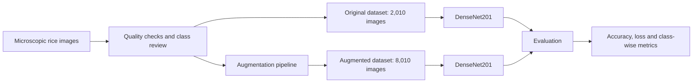

# Rice Microscopy Bangladesh

> A reproducible DenseNet201 benchmark for classifying ten rice varieties from microscopic images collected in Bangladeshi markets.

**Associated publication:** *Grain by Grain: A Microscopic Image Dataset of Rice Varieties from Bangladeshi Rice Markets*<br>
**Journal:** *Data in Brief*, Volume 63<br>
**Published:** December 2025<br>
**DOI:** [10.1016/j.dib.2025.112058](https://doi.org/10.1016/j.dib.2025.112058)<br>
**Dataset:** [Mendeley Data](https://data.mendeley.com/datasets/sfp9s96prh/1)

## Provenance and collaboration

This repository is a provenance-preserving fork of the [canonical research-code repository](https://github.com/maksuranuha/Grain-by-Grain-A-Microscopic-Image-Dataset-of-Rice-Varieties-from-Bangladeshi-Rice-Markets) maintained by **Maksura Binte Rabbani Nuha**. The fork retains the original Git history and is presented by co-author **Md Tahsin** as part of a shared research portfolio.

## Research question

How much does image augmentation affect DenseNet201's ability to distinguish visually similar rice varieties under a controlled microscopic-imaging protocol?

The experiments compare the same transfer-learning backbone on the original dataset and an augmented version, keeping the benchmark easy to inspect and extend.

## Experimental pipeline



## Dataset

- **2,010** original high-resolution images at 640 × 480 pixels.
- **10 rice varieties:** Aush, Beroi, BR-28, BR-29, Ghee Bhog, Katari Nazir, Katari Siddho, Swarna, Miniket, and Chinigura.
- More than 200 original samples per variety, collected from markets in Dhaka, Bangladesh.
- **8,010** images after the reported augmentation procedure.

The dataset supports research into rice-variety identification, authenticity assessment, and computer-vision methods for food-quality workflows. Microscopic appearance alone should not be interpreted as a direct measurement of nutritional composition.

## Model configuration

- **Backbone:** DenseNet201 with transfer learning
- **Input size:** 70 × 70 pixels
- **Head:** global average pooling and softmax classifier
- **Optimizer:** Adam
- **Learning rate:** 0.001
- **Epochs:** 50
- **Batch size:** 60
- **Split:** 80% training, 10% validation, 10% testing

## Reported benchmark

| Dataset version | Images | Accuracy | Loss |
|---|---:|---:|---:|
| Original | 2,010 | 93% | 0.248 |
| Augmented | 8,010 | 94% | 0.230 |

The augmentation experiment produced a one-percentage-point increase in overall accuracy and a lower reported loss. Class-level metrics should be reviewed alongside aggregate accuracy because visually similar varieties do not benefit equally.

## Repository guide

| Notebook | Purpose |
|---|---|
| `DenseNet201_With_Original dataset.ipynb` | Train and evaluate the baseline on original images |
| `DenseNet201_with_Augmented_Dataset.ipynb` | Train and evaluate on augmented images |
| `Augmentation.ipynb` | Generate augmented samples |
| `Black_Background.ipynb` | Prepare controlled image backgrounds |
| `Chart_Generation.ipynb` | Produce comparison and reporting figures |

## Reproducing the experiments

1. Download the dataset from the linked Mendeley Data record.
2. Preserve one directory per rice variety.
3. Open the notebooks in Google Colab or a Python environment with TensorFlow/Keras, scikit-learn, pandas, NumPy, Pillow, OpenCV, Matplotlib, and Seaborn.
4. Update dataset paths without committing private Google Drive locations.
5. Run the original-data experiment before augmentation.
6. Record the random seed, split, library versions, and hardware used for any new result.

## Responsible use and limitations

- The dataset represents selected Bangladeshi market samples and should not be assumed to cover all regional or seasonal variation.
- Augmented images are derived samples, not additional independently collected observations.
- Performance can change with lighting, camera hardware, preprocessing, and train/test splitting.
- Any commercial quality-control deployment requires external validation on unseen acquisition conditions.

## Citation

```bibtex
@article{tahsin2025grain,
  title   = {Grain by grain: A microscopic image dataset of rice varieties from Bangladeshi rice markets},
  journal = {Data in Brief},
  volume  = {63},
  pages   = {112058},
  year    = {2025},
  doi     = {10.1016/j.dib.2025.112058}
}
```

## Research contacts

- [Md Tahsin](https://github.com/T-biohazard) — co-author and portfolio maintainer
- [Maksura Binte Rabbani Nuha](https://github.com/maksuranuha) — co-author and canonical repository maintainer

No standalone software license is declared in the upstream repository. Contact the maintainers before redistributing the notebooks outside GitHub's fork network or incorporating them into another software package.
